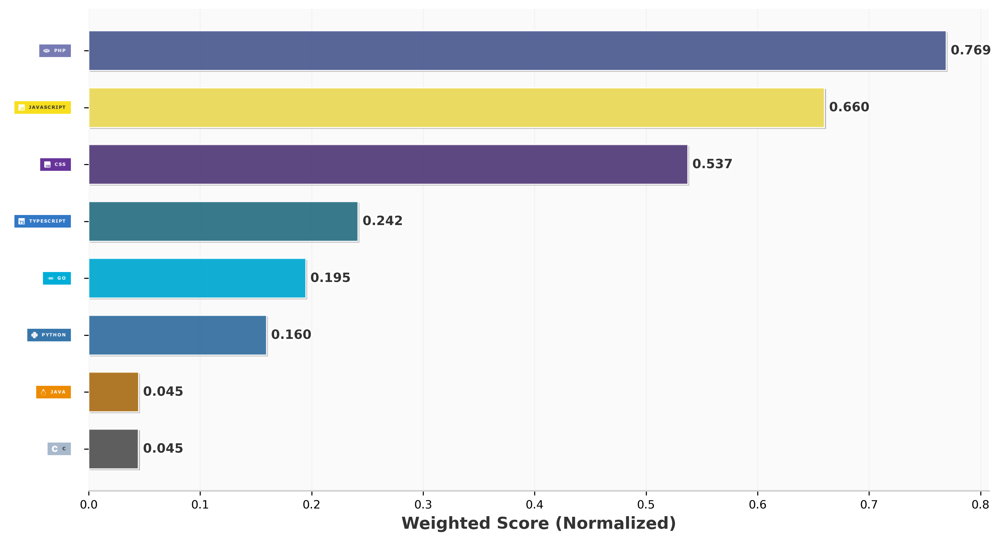

## Hi there 👋

- I am Younes Abourrig Full Stack Developer & Mobile Development Student
- How to reach me:
  - younesabourrig@gmail.com,
  - [LinkedIn](https://www.linkedin.com/in/younes-abourrig-08103a338/)
- my portfolio:
  - [younes's Portfolio](https://myportfolio-phi-seven-63.vercel.app/)
  
## Technologies I Use

## Technologies I Interested to learn

<!--  
## GitHub Stat 

-->

<picture>
  <source media="(prefers-color-scheme: dark)" srcset="https://raw.githubusercontent.com/younesabourrig01/younesabourrig01/pacman-output/pacman-contribution-graph-dark.svg">
  <source media="(prefers-color-scheme: light)" srcset="https://raw.githubusercontent.com/younesabourrig01/younesabourrig01/pacman-output/pacman-contribution-graph.svg">
  
</picture>
